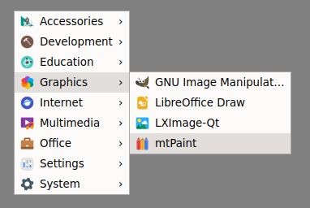
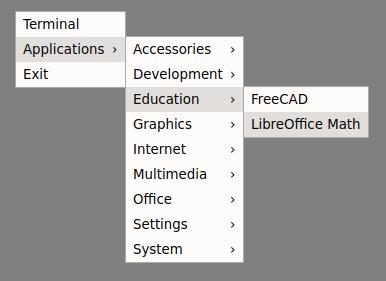
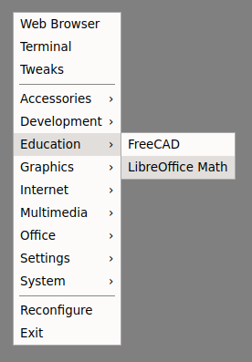

# Overview

`labwc-menu-generator` is a simple, lightweight, easily configurable C program
that generates a full Labwc/Openbox XML-menu based on the information present
in .desktop application files.

Inspired by [obmenu-generator]



Screenshot based on `labwc-menu-generator -I -n > $HOME/.config/labwc/menu.xml`
and using the Papirus icon theme (set in `rc.xml`).

[obmenu-generator]: https://trizenx.blogspot.com/2012/02/obmenu-generator.html

# Features

- Independent of Desktop Environments and associated menu-packages. This is
  achieved by categorising system .desktop files against a built-in
  directory-schema rather than parsing .menu and .directory files (see
  [Menu Specification]).
- [Desktop Entry Specification] compliant parsing of `Desktop Entry` .desktop
  files.
- Openbox 3.6 compliant menu.xml output.
- Localized values for .desktop file keys such as `Name[sr_YU]`
- Icon support (although is ignorant to themes as labwc handles that)
- Support both static and dynamic (pipe) menus

[Desktop Entry Specification]: https://specifications.freedesktop.org/desktop-entry/1.1/
[Menu Specification]: https://specifications.freedesktop.org/menu/1.0/

# Usage

Labwc and Openbox have built-in support for two types of menus: static and
dynamic (also known as "pipe menus").

Static menus are built based on content of XML files. The default menu file,
`menu.xml` (typically located either at `~/.config/labwc/` or `/etc/xdg/labwc/`
is static by default. This is what `labwc-menu-generator` outputs by default
and it takes this format:

```XML
<openbox_menu>
  ...menu stuff here...
</openbox_menu>
```

Dynamic (pipe) menus are by definition generated at runtime based on output of
executable files. They are called by from static menus (typically
`~/.config/labwc/menu.xml`) like this:

```XML
<openbox_menu>
  <menu id="ID" label="TITLE" execute="COMMAND" />
</openbox_menu>
```

`labwc-menu-generator` can output this dynamic/pipe format too by using the
`-p` option. This type of output (stdout) looks like:

```XML
<openbox_pipe_menu>
  <item label="LABEL" icon="ICON">
    ...menu stuff...
  </item>
</openbox_pipe_menu>
```

## a. Basic static menu

Use `labwc-menu-generator` directly to generate the `menu.xml` file:

`labwc-menu-generator > ~/.config/labwc/menu.xml`

## b. Advanced static menu

[update-menu.sh](contrib/update-menu.sh)

In this example we see how a user can:

- Cutomize the menu by adding entries (like a terminal and browser) before
  and/or after the directories
- Ignore specified applications

Use a wrapper-script to generate the `menu.xml` file. For example, if you call
the script below `update-menu.sh`, then simply run:

`./update-menu.sh > ~/.config/labwc/menu.xml`

```bash
#!/bin/sh

ignore_files=$(mktemp)
trap "rm -f $ignore_files" EXIT
cat <<'EOF' >${ignore_files}
libreoffice-startcenter.desktop
cmake-gui.desktop
pcmanfm-qt-desktop-pref.desktop
pcmanfm-desktop-pref.desktop
EOF

printf '%b\n' '<openbox_menu>
<menu id="root-menu" label="root-menu">
  <item label="Web Browser">
    <action name="Execute"><command>firefox</command></action>
  </item>
  <item label="Terminal">
    <action name="Execute" command="foot" />
  </item>
  <separator />'

# -b|--bare    Disables header and footer (as this script provides it)
# -i|--ignore  Excludes all .desktop files listed at the top of this file
labwc-menu-generator -b -i "${ignore_files}"

printf '%b\n' '<separator />
  <item label="Reconfigure">
    <action name="Reconfigure" />
  </item>
  <item label="Exit">
    <action name="Exit" />
  </item>
</menu> <!-- root-menu -->
</openbox_menu>'
```

## c. Basic dynamic menu

To get the feel for how dynamic (pipe) menus work, examine this example
`~/.config/labwc/menu.xml`:

```XML
<openbox_menu>
  <menu id="root-menu" label="root-menu">
    <item label="Terminal" name.action="Execute" command.action="foot" />

    <!-- This is where the pipe menu is called -->
    <menu id="Applications" label="Applications" execute="labwc-menu-generator -p" />

    <item label="Exit" name.action="Exit" />
  </menu>
</openbox_menu>
```



The advantage of of using a pipe menu for the system applications is that it
always shows the up-to-date state of the installed programs.

## d. Advanced dynamic menu

[example-dynamic-root-menu.sh](contrib/example-dynamic-root-menu.sh)

In this example, we are going to use a script that we will call
`example-dynamic-root-menu.sh`. It needs to be executable (i.e. use `chmod +x`)
and be placed in `$PATH`, which on many systems would include `~/bin/`.

Use the following static menu (`~/.config/labwc/menu.xml`) to trigger the
generation of the whole root-menu dynamically.

```XML
<openbox_menu>
  <menu id="root-menu" label="" execute="example-dynamic-root-menu.sh" />
</openbox_menu>
```

`example-dynamic-root-menu.sh`:

```bash
#!/bin/sh

printf '%b\n' '<openbox_pipe_menu>
  <item label="Web Browser">
    <action name="Execute"><command>firefox</command></action>
  </item>
  <item label="Terminal">
    <action name="Execute" command="foot"/>
  </item>
  <separator />'

labwc-menu-generator -b

printf '%b\n' '<separator />
  <item label="Reconfigure">
    <action name="Reconfigure" />
  </item>
  <item label="Exit">
    <action name="Exit" />
  </item>
</openbox_pipe_menu>'
```



This type of setup provides the full power of `labwc-menu-generator`, but also
enables users to customize the menu to their own taste.

## e. Master level dynamic menu

If you wanted to take another step on the journey, adding an abstraction layer
or a dedicated menu syntax could provide a neat solution to end-users.

This simple example provides XML pre-processing on a user configuration file.
To try this out, give the script below a name and call it from menu.xlm just
in the example above with `example-dynamic-root-menu.sh`.

```bash
#!/usr/bin/env bash

filename="$HOME/.config/labwc/my-menu.conf"

mapfile -t lines < "$filename"

for line in "${lines[@]}"; do
  if [[ $line == @@APPS@@* ]]; then
    labwc-menu-generator -b -t foot -I
  else
    printf '%b\n' "$line"
  fi
done
```

The menu can then simply be configured with a `~/.config/labwc/my-menu.conf`
like this:

```XML
<openbox_pipe_menu>

  <item label="Web Browser" name.action="Execute" command.action="firefox" icon="firefox" />
  <item label="Terminal" name.action="Execute" command.action="foot" icon="utilities-terminal" />

  <separator />

@@APPS@@

  <separator />

  <menu id="Exit" label="Exit" icon="application-exit">
    <item label="Reconfigure" name.action="Reconfigure" icon="labwc" />
    <item label="Logout" name.action="Exit" icon="application-exit" />
  </menu>

</openbox_pipe_menu>
```

The sky is your limit here. The example is just there to illustrate how some
abstraction could be achieved.

# Build

To build, simply run:

    meson setup build/
    meson compile -C build/

Run-time dependencies include: `glib-2.0`

Build dependencies include: `meson`, `ninja`, `gcc`/`clang`

# Repology

[](https://repology.org/project/labwc-menu-generator/versions)
